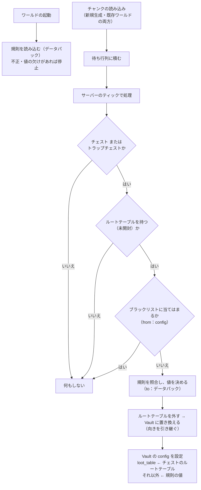

# Chest to Vault 計画（v0.2）

- 作成日：2026-11-14 ／ 更新日：2026-11-15
- Mod：**Chest to Vault**（mod id：`chest2vault`）
- 対象環境：Minecraft 1.21.1 / NeoForge 21.1.x
- 状態：§8 の実装済み。ゲーム内での動作確認（§7）待ち

---

## 1. 目的

構造物に**ルートチェストとして置かれたもの**を、その場でバニラの **Vault** に変換する。

- 何人でも開けられ、1人1回、開けるたびに抽選する（Vault の既存の挙動）
- Lootr に近い「プレイヤーごとに報酬がある」体験を、バニラの仕組みで実現する
- 独自のブロックやブロックエンティティは作らず、バニラの Vault を使う。負荷の問題が起きたときに対応しやすくするため

## 2. 設計の原則

| 原則 | 内容 |
|---|---|
| コードの量 | 例外的な処理は、必要になったら足す |
| 土台 | どんな例外も足しやすい土台を作る。土台には YAGNI を当てはめない |
| config と データパック | **from（何を変換するか）**は config のブラックリストで、**to（何に変換するか）**はデータパックの規則で与える |
| 想定する利用者 | 設定を調整するのは **Modpack の製作者**。config の初期値と組み込みのデータパックで初期の設定を与え、製作者は config の編集とデータパックの追加で調整する |

## 3. 初版（v1）の範囲

### 決定事項

| 項目 | v1 での決定 |
|---|---|
| 変換対象 | **チェスト**・**トラップチェスト**のみ |
| 対象のルートテーブル | 名前空間に関係なく、すべて（他の Mod のものも含む）。外すものは config のブラックリストで指定する（§4.4・§4.6） |
| 変換のタイミング | **チャンクの読み込み時**。新規生成と既存ワールドを区別する分岐は作らない |
| 開け方 | **鍵が必要**（バニラの仕様どおり）。鍵は規則で指定する（§4.3） |
| 大型チェスト | **Vault 2つ**に変換する（それぞれ同じルートテーブル） |
| 元に戻せるか | 戻せない。Mod を外しても Vault のまま残る |
| 規則を変えたとき | 変換済みの Vault には反映しない |
| Lootr | **同時に入れない**前提 |
| 開封者の記録の上限（128人） | 現状は**考慮しない** |
| C2ME | C2ME 側の事情として扱う |
| 負荷 | 現時点では議論しない |

### v1 でやらないこと

- 鍵なしで開ける仕組み（バニラの鍵の判定の書き換え）
- シュルカーボックスなど、チェストと樽以外のコンテナ（樽は v0.3.0 で対象にする。§4.8）
- チェスト付きトロッコ（エンティティなので、Vault に置き換えられない）
- 128人上限の変更、再開封までの時間の追加
- 専用の見た目（テクスチャ）
- 確認用のコマンド（モックの `/chest2vault convert` は消す）
- 鍵の仕組みの改変（ルートの差し替えとは別に扱う）
- Vault の見た目（`ominous` の状態）と `key_item` の組み合わせの補正（次の版で行う）

## 4. 変換の仕組み

### 4.1 前提となるバニラの挙動

- 構造物のルートチェストは、**未開封の間だけ**ルートテーブルの名前を持っている。開けた瞬間に中身が抽選され、名前は消える。
- Vault の設定（`config`）は次のとおり。

| 項目 | 内容 | 既定値 |
|---|---|---|
| `loot_table` | 開けたときに吐き出すルートテーブル | `minecraft:chests/trial_chambers/reward` |
| `key_item` | 開けるのに必要なアイテム（種類・コンポーネント・個数が比較される） | `minecraft:trial_key` |
| `activation_range` | 鍵穴が開く距離 | 4 |
| `deactivation_range` | 鍵穴が閉じる距離 | 4.5 |
| `override_loot_table_to_display` | 檻の中に表示するアイテムの元（任意） | なし |

- `key_item` が空、または `loot_table` が `minecraft:empty` の場合、鍵を差し込めない。
- 排出の回数：ルートテーブルを1回抽選したときの**スタックの数**。1スタックにつき1秒（20ティック）かかる。チェストのようにスロットへ分ける処理はない（`VaultBlockEntity.Server.resolveItemsToEject`、`VaultState.EJECTING`）。

### 4.2 変換の流れ

#### 経路

前の経路ほど早く（事前に）変換し、後の経路ほど取りこぼしをその場で（即時に）拾う。

| 経路 | いつ変換するか | 状態 |
|---|---|---|
| i | 構造物のテンプレートを読み込むときに、テンプレートの中の対象のチェストを Vault に書き換える | v0.2.0 で扱う |
| ii | チャンクの読み込み時（下の図） | v0.0.1 で実装済み |
| iii | プレイヤーがチェストを開けようとしたとき | v0.1.0 で実装済み |

経路 i（テンプレートの書き換え）：

- 目的：チャンクの読み込み時（経路 ii）の置き換えの負荷を下げる。負荷の主な原因は、Mod が追加する構造物。
- 対象：ルートテーブルがテンプレート（NBT）に書いてあるチェスト。バニラでは古代都市・ピグリン要塞・前哨基地・荒廃したポータルなど。Mod の構造物でこの形のものがどれだけあるかは未確認。
- 対象外：テンプレートの外でルートテーブルが付くもの（バニラの古い構造物。置いた後にコードが付けるもの、コードがチェストを置くもの、地物）。これらは経路 ii・iii に任せる。
- 仕組み：NeoForge にテンプレートに割り込むイベントがないので、Mixin を使う。テンプレートを読み込んだ直後に、メモリの中で書き換える（ファイルは作らない）。書き換えは、各テンプレートが初めて読み込まれたときに1回だけ行う。



#### 段階

| 段階 | 用語 | 図の範囲 | ワールドに触るか |
|---|---|---|---|
| いつ（経路 i） | テンプレートの書き換え（TemplateConversion） | テンプレートの読み込み → 中の対象のチェストを Vault に書き換える（何を・何にはほかの経路と共通。どうは、ワールドではなくテンプレートに対して行う） | 触らない（テンプレートだけ） |
| いつ（経路 ii） | 待ち行列（ConversionQueue） | チャンクの読み込み → 待ち行列 → ティック | 触る |
| いつ（経路 iii） | 開封時の変換（OpenConversion） | プレイヤーがチェストを右クリック → その右クリックは止める | 触る |
| 何を（from） | 変換対象（Target） | チェスト・樽か → 未開封か → ブラックリスト | 触らない |
| 何に（to） | 規則の照合（ConversionRule） | 規則を照合し、値を決める | 触らない |
| どう | 置き換え（Replacement） | ルートテーブルを外す → Vault → config | 触る |

- 「何を → 何に → どう」をまとめて**変換（Conversion）**と呼ぶ。どの経路も同じ変換を呼ぶ。
- 経路 iii は、プレイヤーが開けようとする操作だけを対象にする。ホッパーや破壊でルートが出る経路は扱わない。
- 経路 iii で変換したら、何が起きたかを伝える。効果音 `block.chest.locked` をその場で鳴らし、右クリックしたプレイヤーのアクションバーに必要な鍵を出す（英語。翻訳のキーを付け、翻訳がなければ英語の文を使う。翻訳ファイルはまだない）。

- `ChunkEvent.Load` の中ではブロックに触らず、位置を積むだけにする。その場で触るとデッドロックすることがあるため（NeoForge の注意書き）。
- 置き換える前に、チェストからルートテーブルを外す。外さないと、壊したときに中身が抽選されて地面に落ちる（`ChestBlock.onRemove` → `Containers.dropContents` → `getItem()`）。
- 大型チェストは、2つのブロックをそれぞれ独立した Vault にする。
- 抽選の種（シード）は引き継がない。Vault は開けるたびに抽選するため。

### 4.3 鍵

- 当面は `minecraft:trial_key`（規則 `chest2vault:default` で指定する）。
- エンドシティと古代都市（`minecraft:chests/end_city_treasure`、`minecraft:chests/ancient_city*`）は `minecraft:ominous_trial_key`（規則 `chest2vault:ominous`、priority 100）。
- Vault の `ominous` の状態には触らない。見た目は普通の Vault のまま、鍵だけが不吉なものになる。
- 鍵の種類・入手方法などの仕組みは、ルートの差し替えとは別に扱う。

### 4.4 ブラックリスト（from：config）

- 置き場所：`config/chest2vault-common.toml` の `blacklist`（COMMON。全ワールドで共通）
- 書き方：ルートテーブルの ID を glob で書く（例：`minecraft:chests/village/*`、`othermod:*`）
- glob：`*` は `/` を含む任意の文字の並び、`?` は任意の1文字。ID 全体と照合する。照合は commons-io の `FilenameUtils.wildcardMatch`（Minecraft 自身が使っているライブラリ）に任せる。規則の `patterns` も同じ。
- 当てはまったチェストは変換しない（ルートテーブルを持ったまま残る）
- 初期値：§4.6 の対象外。初期値は config ファイルを新しく作るときにだけ使われる。すでにある config ファイルには、版を上げて初期値を変えても反映されない（製作者が書き足す）
- 不正な値は `ModConfigSpec` が WARN のログを出して初期値に直す。この動きをそのまま受け入れる（困ったら検証を足す）

### 4.5 規則（to：データパック）

- 置き場所：`data/<名前空間>/chest2vault/conversion_rule/<名前>.json`（1ファイルに1つの規則）
- Mod の jar に組み込みの規則を入れる。製作者は、データパックを追加して規則を足したり、同じ ID のファイルで組み込みの規則を差し替えたりする。
- 同期用の Codec は渡さない。規則はサーバーだけが使うため。

#### 項目

| 項目 | 内容 |
|---|---|
| `priority` | 適用する順番（必須）。小さい順に適用し、あとのものが優先される。同じ値なら ID の順 |
| `patterns` | 当てはまるルートテーブルの ID（必須。glob。複数書ける） |
| `key_item` | 鍵（ItemStack の JSON：`id`・`count`・`components`） |
| `activation_range` / `deactivation_range` | 反応する距離。どの規則も書かなければバニラの初期値（4.0／4.5） |
| `override_loot_table_to_display` | 檻の中の表示に使うルートテーブル。`null` は書いていないのと同じ。どの規則も書かなければチェストのルートテーブル |

#### 照合

- `patterns` は glob で書く（例：`minecraft:chests/village/*`、`othermod:*`）。
- あるルートテーブルに当てはまる規則を `priority` の順に適用し、**書かれている項目だけ**を上書きする。
- 全体の値は、`patterns: ["*"]` の規則（組み込みの `chest2vault:default`、priority 0）で与える。
- 照合の結果は、バニラの `VaultConfig` として変換に渡す。鍵が決まらなければ誤りになる（起動時の検証で止める）。
- 規則の並び順が必要なのは、1つのルートテーブルに複数の規則が当てはまり、同じ項目を書いているとき。レジストリの項目には順序がないので、`priority` で表す。

#### 検証（不正を握りつぶさない）

- 用語：起動時の検証（Validation）。ワールドに触らない。
- 書式が不正な規則があれば、ワールドの読み込みが止まる（バニラの `RegistryDataLoader` の動き）。
- ワールドの起動時に、読み込まれているルートテーブルのうち**ブラックリストに当てはまらないもの**について、鍵（`key_item`）が決まるかを確かめる。決まらなければ止める。
- 値が足りなくて不便に感じたら、フォールバックをあとで入れる。

#### 例

```json
// data/chest2vault/chest2vault/conversion_rule/default.json
{
  "priority": 0,
  "patterns": ["*"],
  "key_item": { "id": "minecraft:trial_key", "count": 1 }
}
```

```json
// 製作者のデータパック：data/mypack/chest2vault/conversion_rule/bastion.json
{ "priority": 200, "patterns": ["minecraft:chests/bastion_treasure"], "key_item": { "id": "minecraft:ominous_trial_key", "count": 1 } }
```

### 4.6 変換対象のルートテーブル（ブラックリストの初期値）

- 判断基準：建築物の**出現頻度・目的**、および**攻略というテーマに合うか**（規模では決めない）
- 対象外のテーブルは、config のブラックリストの初期値として持つ。
- 対象：バニラ 1.21.1 の `minecraft:chests/*`

| 系統 | ルートテーブル（`minecraft:chests/` 以下） | 変換 | 理由 |
|---|---|---|---|
| 村 | `village/village_{armorer, butcher, cartographer, desert_house, fisher, fletcher, mason, plains_house, savanna_house, shepherd, snowy_house, taiga_house, tannery, temple, toolsmith, weaponsmith}` | ✕ | 攻略の場所ではない |
| イグルー | `igloo_chest` | ✕ | 攻略の場所ではない |
| ボーナスチェスト | `spawn_bonus_chest` | ✕ | 建築物ではない |
| 難破船 | `shipwreck_map`, `shipwreck_supply`, `shipwreck_treasure` | ✕ | 攻略がテーマではなく、差し替える重要性が低い |
| 埋もれた宝 | `buried_treasure` | ✕ | 同上 |
| ダンジョン | `simple_dungeon` | ○ | スポナー部屋。攻略のテーマと目的に合う |
| 荒廃したポータル | `ruined_portal` | ○ | 同上 |
| 海底遺跡 | `underwater_ruin_big`, `underwater_ruin_small` | ○ | 同上 |
| 砂漠の寺院 | `desert_pyramid` | ○ | 攻略の場所 |
| ジャングルの寺院 | `jungle_temple` | ○ | 攻略の場所 |
| ピリジャーの前哨基地 | `pillager_outpost` | ○ | 攻略の場所 |
| 森の洋館 | `woodland_mansion` | ○ | 攻略の場所 |
| 要塞 | `stronghold_corridor`, `stronghold_crossing`, `stronghold_library` | ○ | 攻略の場所 |
| 古代都市 | `ancient_city`, `ancient_city_ice_box` | ○ | 攻略の場所 |
| 試練の間 | `trial_chambers/{corridor, entrance, intersection, supply}` | ○ | 攻略の場所 |
| ネザー要塞 | `nether_bridge` | ○ | 攻略の場所 |
| 砦の遺跡 | `bastion_bridge`, `bastion_hoglin_stable`, `bastion_other`, `bastion_treasure` | ○ | 攻略の場所 |
| エンドシティ | `end_city_treasure` | ○ | 攻略の場所 |
| （チェストではない） | `abandoned_mineshaft`（チェスト付きトロッコ）, `jungle_temple_dispenser` | － | チェストのブロックではないので、設定に関係なく変換されない（`jungle_temple_dispenser` は名前からの推測で、未確認） |
| 試練の間 | `trial_chambers/*`（テンプレートに `entrance` のチェスト7、`reward` のチェスト3、`supply` のチェスト1、`intersection_barrel` の樽2、`corridor` の樽1。確認済み） | ×（v0.3.0 から） | 挑戦者向けの一時置き場や補給で、宝箱ではない。ブラックリストの初期値に `minecraft:chests/trial_chambers/*` を入れる |

### 4.7 命名規則

| 対象 | 規則 |
|---|---|
| Mod の ID・名前空間 | `chest2vault` |
| Mod の表示名 | `Chest to Vault` |
| JSON の項目名 | snake_case。Vault の設定の項目名は、バニラの `VaultConfig` と同じにする |
| データパックの種類名 | 単数形（1.21 の慣習）。`conversion_rule` |
| クラス名（Mod の入り口） | Mod の ID（`Chest2Vault`）。登録だけを持つ |
| クラス名（それ以外） | plan の用語の英訳（§4.2「段階」）。plan にない言葉が要るときは、先に plan に足す |


### 4.8 樽（v0.3.0）

- 樽も変換の対象にする。判定（変換対象）以外は、チェストと同じ（規則の照合、3つの経路）。
- バニラの Vault に、状態 `appearance`（見た目）を Mixin で足す。値は `vault`（初期値）と `barrel`。値が決まっていなければ `vault` なので、バニラの Vault と整合する。チェストから変換したものは `vault` のまま。
- 樽から変換したものは `appearance=barrel` にする。
- 向き：Vault は水平の4方向だけ。横向きの樽は同じ向き、上・下向きの樽は北向きにする。
- 見た目：Vault の見た目の定義（`assets/minecraft/blockstates/vault.json`）を Mod で上書きし、`appearance=barrel` には樽のモデルを使う。絵はバニラの樽のものだけを使う（新しい絵は後で）。上にふたがある樽の見た目にする。
- 用語：見た目（VaultAppearance）。
## 5. 既知の影響・リスク

| 項目 | 内容 | v1 の扱い |
|---|---|---|
| トラップチェストのレッドストーン信号 | 開けたときの信号が出なくなる。罠の仕掛けが動かなくなる | 受け入れる（要確認：影響する構造物があるか） |
| 見た目 | 構造物に試練の間の見た目の Vault が置かれる | 受け入れる |
| 報酬の渡し方 | インベントリではなく、アイテムを吐き出す形になる | 受け入れる |
| 大型チェスト | 報酬が2回分になり、ルート量が増える | 受け入れる（バランスは後で確認） |
| 他mod | ルートチェストの存在を前提にした mod（クエスト等）が動かなくなる可能性 | 動作確認で洗い出す |
| 誤変換 | プレイヤーが置いたチェストに、コマンド等でルートテーブルを付けた場合も変換される | 受け入れる |
| 表示で地図が作られ続ける | 近くにプレイヤーがいる間、表示のために1秒ごとにルートテーブルが抽選される。`exploration_map` を含むテーブル（`underwater_ruin_*` など）では、そのたびに地図が新しく作られる | 受け入れる。必要になったら `override_loot_table_to_display` で対処する |
| 試練の鍵の入手 | 試練の間を見つけるまで、Vault を開けられない | 暫定として受け入れる（鍵の仕組みは別に扱う） |
| Vault の破壊 | 変換した Vault を壊したときの動作 | バニラの Vault の動作のまま。Mod のコードでは扱わない（例外は必要になったら足す） |

## 6. 確かめたこと（モックで検証）

- [x] チャンク読み込み時に置き換える方法：`ChunkEvent.Load` で位置を積み、`ServerTickEvent.Post` で処理する
- [x] Vault のブロックエンティティに、コードから `config` を設定する方法：`VaultBlockEntity.setConfig(VaultConfig)`（public）
- [x] ルートテーブルを持つチェストの判定方法：`RandomizableContainerBlockEntity.getLootTable() != null`
- [x] ルートテーブルを引き継いだ変換（コマンド・自然生成で確認）
- [x] ルートテーブルによる出し分け（設定のブラックリストで確認）
- [x] データパックの規則：組み込みの規則・追加したデータパックの規則・同じ ID での差し替え（`priority` だけを持つ規則で確認）
- [ ] 鍵を差し込んで排出させる動作（ゲーム内で確認する）
- [ ] 規則の照合（glob・項目ごとの上書き）と、起動時の検証

## 7. 動作確認の計画

| 確認項目 | 方法 | 期待する結果 |
|---|---|---|
| 新規生成での変換 | 新しいワールドでダンジョンなどを探す | ルートチェストが Vault になっている |
| 対象外 | 村を探す | 村のチェストはチェストのまま |
| 既存ワールドでの変換 | 未開封のチェストがある既存ワールドを読み込む | 未開封のものだけが Vault になる |
| 開封済みチェスト | 開けたことのあるチェストのチャンクを読み込む | 変換されない |
| 大型チェスト | 大型チェストのある構造物を探す | Vault が2つになる |
| 鍵 | 規則で指定した鍵で開ける | 指定した鍵でだけ開く |
| 規則の検証 | 不正な規則・値の欠けた規則を入れる | ワールドの読み込みが止まる |
| ブラックリスト | glob（`minecraft:chests/village/*`）を書く | 当てはまるチェストは変換されない |

## 8. 次にやること

1. ブラックリストを glob に対応させる（済：2026-11-15）
2. データパックの規則に Vault の設定の値を持たせ、変換の処理につなぐ（済：2026-11-15）
3. 起動時の検証を作る（済：2026-11-15）
4. 確認用のコマンドを消す（済：2026-11-15）
